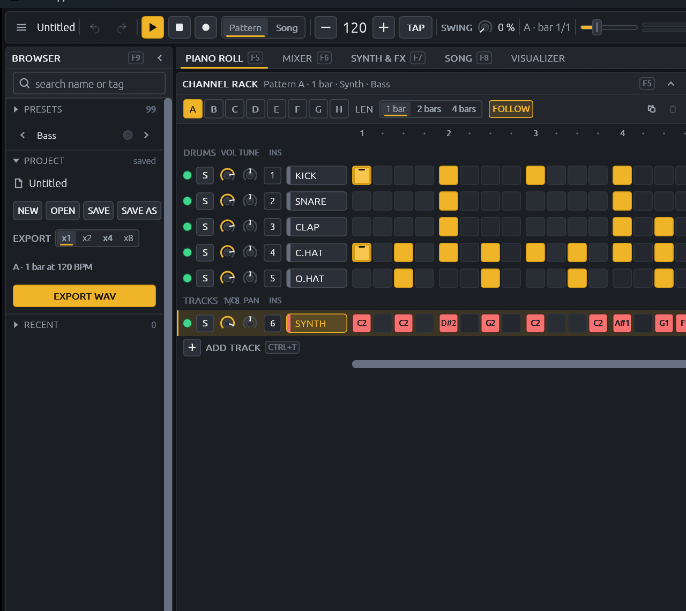

# BeatSlopper

**An open-source audio toy written in Rust, slowly growing every bell and whistle of a full
DAW like FL Studio or Ableton Live.**

BeatSlopper is a just-for-fun project: open it, tap out a drum loop, play a synth from your
computer keyboard, layer a few tracks, push the faders around and export a WAV. No account,
no plugins to install, no sample packs to download. Every drum and synth sound is generated in
code.



*Work-in-progress capture of the current "Deck" layout (milestone M12). The right side is
cropped by a known narrow-window bug that is next on the list.*

---

## Contents

- [Features](#features)
- [Install and run](#install-and-run)
- [Quick start: your first beat in five minutes](#quick-start-your-first-beat-in-five-minutes)
- [Usage guide](#usage-guide)
- [Keyboard shortcuts](#keyboard-shortcuts)
- [Project files and export](#project-files-and-export)
- [Roadmap](#roadmap)
- [Building from source and running the tests](#building-from-source-and-running-the-tests)
- [Project layout](#project-layout)
- [Contributing](#contributing)
- [License](#license)

## Features

What works today:

- **Computer-keyboard piano** - play the synth on `A W S E D F T G Y H U J K O L P ;`,
  shift octaves with `Z` / `X`, set the velocity. MIDI keyboards work too.
- **Synth** - two band-limited oscillators (sine, saw, square with pulse width, triangle), unison up to
  7 voices, sub oscillator, noise, FM, a plucked-string mode, a multi-mode filter with its
  own envelope, key tracking, velocity, pitch envelope, LFO, glide; 16-voice polyphony per track.
- **99 presets** in 8 categories (lofi keys, guitars and pads; EDM leads, bass, plucks, pads
  and risers), searchable by name or tag.
- **Procedural drum kit** - kick, snare, clap, closed and open hat, each with volume and tune.
- **Channel rack step sequencer** - 16 steps per bar, accents, drag-painting, swing, per-row
  mute and solo.
- **Up to 8 instrument tracks**, each with its own synth, preset, colour and insert.
- **Piano roll** - draw, move, resize, select and delete notes, a velocity lane, ghost notes
  from the other tracks, and a chord palette that places a whole chord with one click.
- **Patterns and song mode** - eight patterns (A to H) of 1, 2 or 4 bars, chained into a song
  with repeats.
- **FL-style mixer** - 16 inserts plus master, each with level, pan, mute, solo, delay and
  reverb sends, an EQ3, three effect slots (compressor, drive, lo-fi, chorus, EQ3) and routing
  to higher inserts.
- **Effects** - drive, BPM-synced delay, reverb, chorus, lo-fi (bit crush and sample-rate
  reduction), sidechain ducking from the kick, a 7-band parametric master EQ with a spectrum
  analyser, and a soft limiter on the master.
- **Visualizers** - oscilloscope, bars, radial, vector, waves and particles, with a full-screen
  mode.
- **Undo / redo** for every edit, a recent-projects list, typed value entry on every knob,
  tap tempo.
- **Save and load** projects as JSON, and **export to WAV** (a pattern looped 1, 2, 4 or 8
  times, or the whole song).
- **Light and dark themes**, following the OS by default.

## Install and run

There are no prebuilt downloads yet, so you build it with Cargo. It takes a few minutes the
first time.

### 1. Prerequisites

- **Rust**, stable, 1.85 or newer (the workspace uses edition 2024). Install it from
  [rustup.rs](https://rustup.rs).
- **Windows:** the Visual Studio 2022 Build Tools with the "Desktop development with C++"
  workload (Rust needs its linker). If Windows **Smart App Control** is on, it blocks the
  programs Cargo compiles, including BeatSlopper itself; turn it off under Windows Security ->
  App & browser control -> Smart App Control.
- **Linux:** the ALSA development headers (for example `libasound2-dev` on Debian or Ubuntu)
  for audio output and MIDI input.
- **macOS:** the Xcode command line tools (`xcode-select --install`).

BeatSlopper is developed and tested on Windows 11. The libraries it uses (eframe, cpal, midir)
also support Linux and macOS, but those platforms are untested so far; reports welcome.

### 2. Get the code and run it

```bash
git clone https://github.com/MadiWilly/BeatSlopper.git
```

```bash
cd BeatSlopper
```

```bash
cargo run --release -p app
```

Always use `--release`: a debug build works, but the audio can crackle.

The window sizes itself to your screen (minimum 840 x 600) and opens in your OS theme. Plug in
a MIDI keyboard before or after launch; it shows up in the toolbar's MIDI menu.

To check that a build starts without opening an interactive session, run
`cargo run --release -p app -- --smoke-test`: it opens the window, renders about 60 frames and
exits with code 0.

### 3. Optional (Windows): a desktop shortcut

```powershell
powershell -ExecutionPolicy Bypass -File scripts\install.ps1
```

This builds a release, installs it to `%LOCALAPPDATA%\Programs\BeatSlopper` and adds
BeatSlopper to the Desktop and the Start menu. Re-run it to update (close BeatSlopper first);
pass `-NoDesktopShortcut` for the Start menu entry only. The icon's source is
`crates/app/assets/icon.svg`; after editing it, run `node scripts/make-icon.mjs` (needs Node
and Microsoft Edge) to regenerate `icon.png` and `icon.ico`.

## Quick start: your first beat in five minutes

1. **Start the transport.** Press `Space`. The playhead runs across the channel rack.
2. **Program a kick.** In the KICK row, click steps 1, 5, 9 and 13 (the first step of each
   beat). Click and drag across steps to paint several at once.
3. **Add snare, clap and hats.** Click steps on the SNARE and CLAP rows (5 and 13 are a classic
   backbeat), and every other step on C.HAT. Shift-click or Ctrl-click a step to accent it.
4. **Pick a sound.** In the BROWSER column on the left, open PRESETS and pick something from
   EDM Bass or Lo Keys. Use the `<` / `>` arrows (or `Ctrl+PageUp` / `Ctrl+PageDown`) to flip
   through presets while the loop plays.
5. **Play along.** Press keys on your computer keyboard: `A` is C, `W` is C#, `S` is D, and so
   on along the home row. `Z` and `X` move the octave down and up.
6. **Write the bassline.** Click a step in the SYNTH row to select it, then press a key to put
   that note there. Or press `R` to arm recording and just play: the notes are quantised into
   the pattern.
7. **Go wider.** Press `F5` for the piano roll and draw longer notes or chords. Press `Ctrl+T`
   to add another track with a different preset and layer it.
8. **Mix it.** Press `F6` for the mixer. Pull faders, add a compressor or chorus to a slot,
   send some reverb.
9. **Save and export.** `Ctrl+S` saves the project. `Ctrl+E` exports the loop to a WAV file.

## Usage guide

### The screen

From top to bottom:

| Area | What it holds |
| --- | --- |
| **Toolbar** | The menu (new, open, recent, save, export, test tone), project name, undo / redo, play / stop / record, the Pattern / Song switch, BPM with `-` / `+` and TAP, swing, the song position, master volume and meter, the MIDI port menu, the view buttons and the theme switch. |
| **Browser** (left, `F9`) | PRESETS (search, categories, the current preset with previous / next), PROJECT (new, open, save, export) and RECENT projects. Collapses to a thin rail. |
| **Channel rack** | The step sequencer: pattern tiles A to H, length, the drum rows and one row per instrument track. Always on screen; collapse it with its chevron or drag its right edge to resize it. |
| **Main view** | One of PIANO ROLL (`F5`), MIXER (`F6`), SYNTH & FX (`F7`), SONG (`F8`) or VISUALIZER, picked from the tab strip or the F-keys. |
| **Mixer bar** | A one-line summary of the mixer with the master meter; click it (or press `F6`) to open the mixer. |
| **Keyboard strip** | The on-screen piano with octave and velocity controls. Click keys with the mouse or play them from the computer keyboard. Collapsible. |
| **Hint bar** | The most useful shortcuts and the audio device line. |

Hover any control for a tooltip. Click any numeric readout (or right-click a knob) to type an
exact value: units are understood, so `128 bpm`, `-6 dB`, `70%`, `2.4k` and `L 30` all work.
Double-click a knob to reset it.

### Playing notes

- **Computer keyboard:** `A W S E D F T G Y H U J K O L P ;` cover about one and a half
  octaves, laid out like piano keys (the `W E T Y U O P` row are the black keys). At the
  default octave 4, `A` is C4 and `H` is A4 (440 Hz).
- `Z` / `X` shift the octave (1 to 7). Holding a key does not retrigger it.
- **Velocity** is set in the keyboard strip (default 80 %).
- **MIDI:** pick your device from the toolbar's MIDI menu. The LED lights while a port is open,
  and the choice is remembered.
- Notes always go to the **selected track** (the highlighted row in the channel rack). Switch
  tracks with `Alt+Up` / `Alt+Down` or by clicking a track's name.
- `Escape` stops the test tone and clears selections; press it twice quickly to silence every
  note (panic).

### Channel rack (step sequencer)

- **Drum rows:** click a step to toggle it, drag across steps to paint, Shift-click or
  Ctrl-click to toggle the accent, right-click to clear.
- **Track rows:** click a step to select it, then play a key to set its note. `Up` / `Down`
  nudge the selected note by a semitone, `PageUp` / `PageDown` by an octave, `Delete` clears
  it. Ctrl-click toggles the accent, right-click clears the step.
- **Row controls**, left to right: the LED (click to mute, right-click to solo), S (solo), the
  volume knob, tune (drums) or pan (tracks), and the insert number box (which mixer insert the
  row plays through; click it to pick another).
- **Row names:** double-click a drum name to mute it (Shift + double-click to solo).
  Double-click a track name to rename it. Right-click any name for the row menu: mute, solo,
  clear, and for tracks rename, duplicate, delete, move up / down, change colour and "Link to
  free insert".
- **Patterns:** click A to H to switch. While playing, the switch waits for the end of the bar
  (the queued letter blinks). LEN sets 1, 2 or 4 bars; lengthening copies the loop into the
  new bars. FOLLOW keeps the view on the playing bar. Copy, Paste and Clear work on the whole
  pattern.
- **Tracks:** ADD TRACK (`Ctrl+T`) adds an instrument track, up to 8. `Ctrl+Shift+D`
  duplicates the selected one.

### Piano roll (`F5`)

Shows the selected track's notes for the current pattern, with the other tracks' notes as
faint ghosts.

- **Draw:** click an empty cell for a short note, or press and drag right for a longer one.
- **Move:** drag a note. **Resize:** drag its right edge.
- **Select:** click a note; Ctrl-click adds or removes notes from the selection; Ctrl-drag on
  an empty area draws a selection box; `Ctrl+A` selects everything.
- **Delete:** double-click a note, right-click it (or hold the right button and sweep over
  several), or press `Delete` with a selection.
- **Nudge:** arrow keys move the selection by a step or a semitone; `Ctrl+Up` / `Ctrl+Down`
  by an octave.
- **Velocity:** drag in the velocity lane under the grid. Shift-click a note toggles its
  accent.
- **Chords:** pick a chord in the CHORDS column, then every note you draw becomes that chord.
- The mouse wheel scrolls the pitch range. The toolbar has the track picker, zoom, GHOSTS and
  BLACK KEYS toggles and a pop-out button that puts the roll in its own window.

### Presets and sound design (`F7`)

- The BROWSER's PRESETS section lists all 99 presets. Type in the search box to filter by
  name or tag (`Ctrl+Shift+P` jumps there), or pick a category chip.
- The SYNTH & FX view shows every parameter of the selected track's synth beside the FX rack.
  Change anything and the preset shows a MODIFIED light; the sound is saved with the project.
- The EQ and REVERB buttons in the view's toolbar open pop-out windows: a 7-band parametric EQ
  with a live spectrum analyser and draggable nodes, and a reverb editor with pre-delay,
  width, wet filters and a decay display. Both come with presets.

### Mixer (`F6`)

- 16 numbered inserts plus MASTER. Every drum row and track plays into an insert (the number
  box in its rack row picks which).
- Each insert has a fader with a meter, pan, mute, solo, delay and reverb sends, an EQ3, three
  effect slots and a route selector that can send it into a higher insert (for example, route
  kick, snare and clap into one DRUMS bus and compress it there).
- Click a slot to pick an effect: compressor, drive, lo-fi, chorus or EQ3. Double-click an
  insert's name to rename it; click its colour chip to cycle the colour.
- `Ctrl+L` links the selected track to the next free insert.

### Song mode (`F8`)

- Switch the toolbar from **Pattern** to **Song** to play the chain instead of looping one
  pattern.
- In the SONG view, add entries, pick each entry's pattern and how many times it repeats, and
  reorder them with the arrows.
- In song mode, export renders the whole song.

### Visualizer

Pick the VISUALIZER tab and step through its presets. `F11` covers the workspace with the
full-size visualizer; `Escape` or `F11` closes it.

## Keyboard shortcuts

| Keys | Action |
| --- | --- |
| `Space` | Play / stop |
| `R` | Arm recording (notes you play are written into the pattern) |
| `Home` | Restart the loop while playing |
| `+` / `=` or `Ctrl+Up` | BPM up |
| `-` or `Ctrl+Down` | BPM down |
| `A W S E D F T G Y H U J K O L P ;` | Piano keys |
| `Z` / `X` | Octave down / up |
| `Ctrl+Z` | Undo |
| `Ctrl+Y` or `Ctrl+Shift+Z` | Redo |
| `Ctrl+N` | New project |
| `Ctrl+O` | Open project |
| `Ctrl+Shift+O` | Recent projects |
| `Ctrl+S` | Save |
| `Ctrl+Shift+S` | Save as |
| `Ctrl+E` | Export WAV |
| `Ctrl+T` | Add track |
| `Ctrl+Shift+D` | Duplicate track |
| `Alt+Up` / `Alt+Down` | Previous / next track |
| `Ctrl+PageUp` / `Ctrl+PageDown` | Previous / next preset |
| `Ctrl+Shift+P` | Find a preset |
| `Ctrl+L` | Link the selected track to a free mixer insert |
| `F5` | Piano roll |
| `F6` | Mixer |
| `F7` | Synth & FX |
| `F8` | Song |
| `F9` | Show / hide the browser |
| `F11` | Full-screen visualizer |
| `Escape` | Clear selections, stop the test tone; twice quickly = all notes off |

On macOS, `Ctrl` is `Cmd`.

## Project files and export

- Projects are saved as `.beatslopper.json`: plain JSON holding the patterns, notes, tracks,
  synth settings, mixer and effects. Files from older versions of BeatSlopper load and are
  upgraded automatically; a file from a newer version is refused rather than misread.
- The title bar and the PROJECT section show a dot when there are unsaved changes, and New /
  Open ask before discarding them.
- **Export** renders offline (faster than real time, on a background thread) to a 16-bit
  stereo WAV: the current pattern repeated 1, 2, 4 or 8 times (pick it in the PROJECT
  section), or the whole song in song mode, plus a short tail so the reverb and delay can ring
  out.

## Roadmap

The goal is a toy with everything a full DAW has, built a piece at a time and for fun. Near
term (the Deck UI overhaul):

- **M13:** the mixer as a push-up drawer with a side column for the selected insert, the
  SYNTH & FX view regrouped, Draw / Select tools and snap in the piano roll, and the
  narrow-window fixes.
- **M14:** a SONG timeline, browser and plugin-window polish, the keyboard strip finished.

Further out, in no particular order:

- Audio clips and a sampler: drag in WAVs, slice loops, a drum sampler with your own kits
- Audio and microphone recording
- An arrangement timeline with clips, like FL's playlist or Ableton's arrangement view
- An Ableton-style session view for launching clips live
- Automation lanes for any parameter
- More instruments (wavetable, a 303-style bass box, drum synth voices) and more effects
- Hosting VST3 / CLAP plugins
- MIDI export and import, MIDI controller mapping
- Stem export, MP3 / FLAC export
- Prebuilt downloads for Windows, macOS and Linux

## Building from source and running the tests

The full check the project runs before every milestone:

```bash
cargo fmt --all -- --check
```

```bash
cargo clippy --workspace --all-targets -- -D warnings
```

```bash
cargo test --workspace
```

```bash
cargo deny check licenses
```

```bash
cargo build --release
```

The tests (about 900) render audio offline and measure it (pitch, level, brightness, timing),
and drive the UI headlessly with `egui_kittest`, so they need no sound card or display.
`cargo deny` needs [cargo-deny](https://github.com/EmbarkStudios/cargo-deny)
(`cargo install cargo-deny`); it keeps every dependency on a permissive license.

A widget gallery for the UI kit runs with `cargo run -p neu --example gallery`.

## Project layout

A Cargo workspace of three crates:

| Crate | What it is |
| --- | --- |
| [`crates/engine`](crates/engine) | All DSP and sequencing: synth voices, drums, effects, mixer, patterns, presets, the project format and the offline WAV renderer. No UI and no audio-device code, so everything is testable offline. The audio thread never allocates or locks; the UI talks to it through lock-free queues. |
| [`crates/neu`](crates/neu) | The egui widget kit and theme tokens: knobs, sliders, step cells, piano keys, piano roll, meters, visualizers and the shell pieces. |
| [`crates/app`](crates/app) | The desktop app (eframe): the layout, app state, undo, shortcuts, project files, cpal audio output and midir MIDI input. Builds the `beatslopper` binary. |

More detail:

- [`docs/ARCHITECTURE.md`](docs/ARCHITECTURE.md) - interfaces and as-built notes for every
  milestone
- [`docs/PLAN.md`](docs/PLAN.md) - the build briefs, milestone by milestone
- [`PROGRESS.md`](PROGRESS.md) - what is done and what is next
- [`DECISIONS.md`](DECISIONS.md) - why things are the way they are
- [`design/round3/WINNER.md`](design/round3/WINNER.md) - the current design tokens and layout

## Contributing

Issues and pull requests are welcome; it is a hobby project, so keep it fun. Before opening a
PR, run the checks above (fmt, clippy with `-D warnings`, the tests). Two rules matter most:

- Nothing on the audio thread allocates, locks or does I/O. Add parameters as messages through
  the engine's queues.
- New dependencies must have a permissive license (`cargo deny check licenses` enforces it).

## License

Licensed under either of

- Apache License, Version 2.0 ([LICENSE-APACHE](LICENSE-APACHE))
- MIT license ([LICENSE-MIT](LICENSE-MIT))

at your option.

Unless you explicitly state otherwise, any contribution intentionally submitted for inclusion
in the work by you, as defined in the Apache-2.0 license, shall be dual licensed as above,
without any additional terms or conditions.
